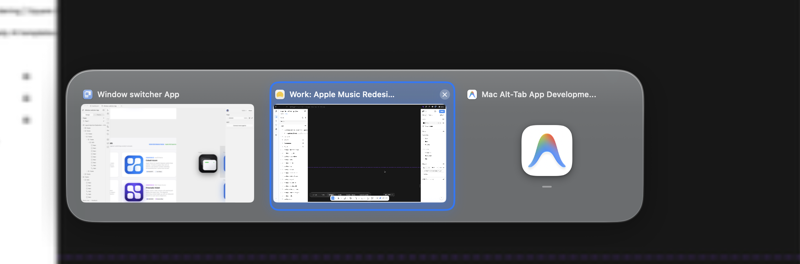
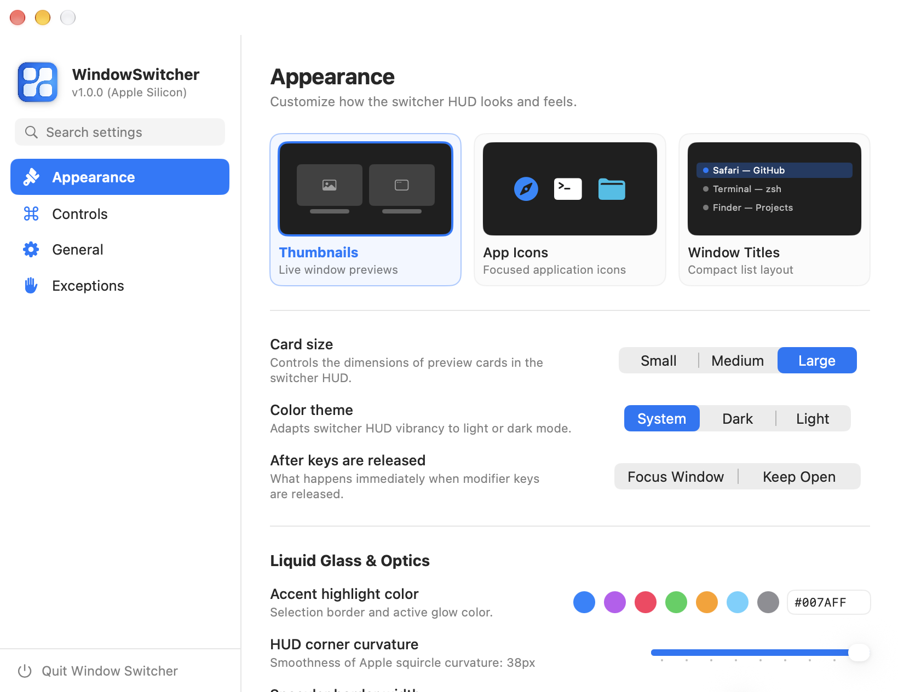
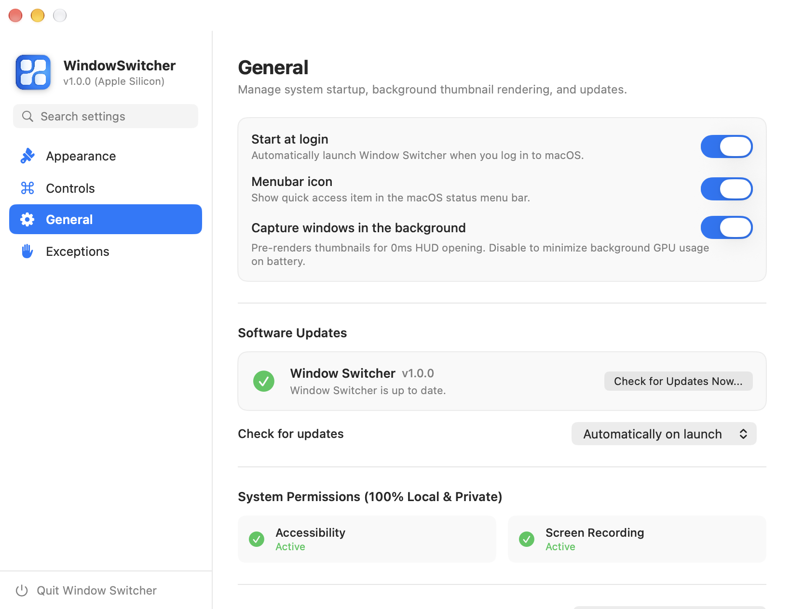

# Window Switcher for macOS

<p align="center">
  
</p>

<p align="center">
  <strong>The fast, elegant window switcher designed for macOS.</strong><br>
  Cycle through individual windows with live previews, fluid keyboard navigation, and an authentic Apple Liquid Glass interface.
</p>

<p align="center">
  <a href="https://github.com/TheLegend96/WindowSwitcher/releases/latest">
    
  </a>
  
  
  
</p>

---

<p align="center">
  
</p>

## Why Window Switcher?

macOS Command-Tab switches between *entire applications*, not individual windows. If you have five browser windows or multiple code editor projects open, macOS bunches them all together.

**Window Switcher solves this.** It brings true window-by-window switching to your Mac with:
- **Individual Window Targeting**: Jump directly to any open document, tab, or editor instantly.
- **Authentic Apple Liquid Glass HUD**: Built with native macOS system materials, subtle specular light-catch borders, and smooth continuous squircle curvature.
- **Hardware-Accelerated 60 FPS Previews**: Powered by Apple’s ScreenCaptureKit engine directly on the GPU for zero-lag, instant visual updates.
- **Search While Switching**: Simply start typing any word to immediately filter your open windows in real-time.
- **100% Free & Open**: No subscriptions, no ads, no "Pro" paywalls.

---

## 🚀 Download & Installation

> **No coding or terminal required!** You can install Window Switcher in seconds:

1. **[Download WindowSwitcher.dmg](https://github.com/TheLegend96/WindowSwitcher/releases/latest)** from the latest release.
2. Open the downloaded `.dmg` file and drag **WindowSwitcher.app** into your **Applications** folder.
3. Launch **Window Switcher** from Applications or Spotlight.
4. When prompted, grant two standard macOS system permissions in **System Settings > Privacy & Security**:
   - **Accessibility**: Needed to register the global shortcut and activate your chosen window.
   - **Screen Recording**: Needed by macOS ScreenCaptureKit to display live preview thumbnails.

That's it! Press **`⌥ Option + Tab`** (or **`⌘ Command + Tab`**) to start switching.

---

## ⌨️ How to Use

| Action | Shortcut |
| :--- | :--- |
| **Cycle forward** through open windows | Hold `⌥ Option` and tap `Tab` (or `⌘ Command + Tab`) |
| **Cycle backward** | Hold `⌥ Option + ⇧ Shift` and tap `Tab` |
| **Switch & focus window** | Release the modifier key (`⌥ Option` or `⌘ Command`) |
| **Close a window directly** | Press `W` while highlighting any window card |
| **Instant filter / search** | Type letters while the switcher is open (e.g. `Figma`, `Code`, `Safari`) |
| **Navigate with arrows or mouse** | Use `←` / `→` arrow keys or hover and click with your trackpad |
| **Cancel switcher** | Press `Esc` |

---

## 🎨 Designed for macOS

<p align="center">
  
</p>

- **Customizable Appearance**: Choose between live window thumbnails, clean app icons, or compact text titles.
- **Optics & Glass Craft**: Fine-tune background opacity, specular hairline highlights, corner curvature, and drop shadow depth.
- **Automatic In-App Updates**: Check for the latest releases directly from Settings with one click.

<p align="center">
  
</p>

---

## 🛠️ For Developers: Building from Source

If you want to modify the source code or build the project yourself:

### Prerequisites
- macOS 14.0 (Sonoma) or newer
- Apple Silicon Mac (M1/M2/M3/M4)
- Xcode Command Line Tools (`xcode-select --install`)

### Compile & Run
```bash
# Clone the repository
git clone https://github.com/TheLegend96/WindowSwitcher.git
cd WindowSwitcher

# Build the signed application bundle
./build.sh

# Install into /Applications and launch
./install.sh
```

To create a clean, shareable `.dmg` installer:
```bash
./create_dmg.sh
```

---

## 📄 License

This project is licensed under the MIT License.
